<div align="center">

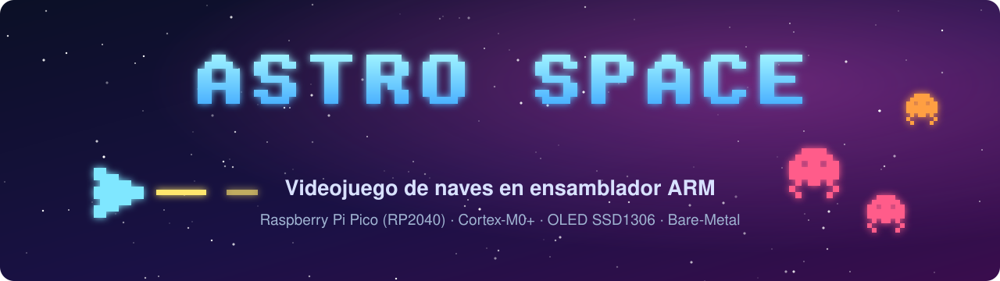

<br/>

<!-- Insignias principales -->
<a href="#-hardware-utilizado"></a>
<a href="#-arquitectura-del-software"></a>
<a href="#-arquitectura-del-software"></a>
<a href="#-compilación-y-carga"></a>

<a href="#-esquema-de-conexión-electrónica"></a>
<a href="#-cálculo-de-tiempos-de-refresco"></a>
<a href="#-uso-de-la-pila-y-estándar-aapcs"></a>
<a href="#-requisitos-del-proyecto-y-dónde-se-cumplen"></a>

<a href="#-autor"></a>
<a href="#-autor"></a>
<a href="#-cómo-se-juega"></a>

<br/><br/>

**ASTRO SPACE** es un videojuego de naves en 2D programado **100 % en ensamblador ARM** para la **Raspberry Pi Pico**.<br/>
Controla directamente los registros del RP2040 (ADC, GPIO, I2C, Timer y NVIC) **sin SDK, sin API de Arduino y sin librerías gráficas**.

[Cómo se juega](#-cómo-se-juega) ·
[Hardware](#-hardware-utilizado) ·
[Conexiones](#-esquema-de-conexión-electrónica) ·
[Máquina de estados](#-máquina-de-estados-del-juego) ·
[Mapa de memoria](#-mapa-de-memoria) ·
[Tiempos](#-cálculo-de-tiempos-de-refresco) ·
[Pila y AAPCS](#-uso-de-la-pila-y-estándar-aapcs) ·
[Compilar](#-compilación-y-carga)

</div>

---

## 📑 Tabla de contenidos

1. [Descripción](#-descripción)
2. [Capturas de pantalla](#-capturas-de-pantalla)
3. [Cómo se juega](#-cómo-se-juega)
4. [Requisitos del proyecto y dónde se cumplen](#-requisitos-del-proyecto-y-dónde-se-cumplen)
5. [Hardware utilizado](#-hardware-utilizado)
6. [Esquema de conexión electrónica](#-esquema-de-conexión-electrónica)
7. [Arquitectura del software](#-arquitectura-del-software)
8. [Máquina de estados del juego](#-máquina-de-estados-del-juego)
9. [Ciclo de un cuadro (tick)](#-ciclo-de-un-cuadro-tick)
10. [Mapa de memoria](#-mapa-de-memoria)
11. [Cálculo de tiempos de refresco](#-cálculo-de-tiempos-de-refresco)
12. [Uso de la pila y estándar AAPCS](#-uso-de-la-pila-y-estándar-aapcs)
13. [Detalles de implementación](#-detalles-de-implementación)
14. [Compilación y carga](#-compilación-y-carga)
15. [Estructura del repositorio](#-estructura-del-repositorio)
16. [Autor](#-autor)

---

## 🚀 Descripción

El jugador controla una nave con un **joystick analógico**. Desde la derecha llegan tres enemigos y la nave los destruye con un **láser automático**.

| Elemento | Regla |
| :-- | :-- |
| 🛸 **Nave** | Se mueve en X y Y con el joystick, a 1 o 2 píxeles por cuadro según la inclinación |
| 🔫 **Láser** | Se dispara solo, avanza 5 px por cuadro y solo hay uno en pantalla a la vez |
| 👾 **Enemigos** | Son 3, avanzan 2 px por cuadro y reaparecen a una altura pseudoaleatoria |
| ⭐ **Puntos** | +10 por cada enemigo destruido, hasta un máximo de 999 |
| ❤️ **Vidas** | Empiezas con 3 y pierdes una cada vez que un enemigo choca con tu nave. Los que escapan por la izquierda reaparecen a la derecha sin quitarte vida |
| 💀 **Fin** | Con 0 vidas aparece **GAME OVER** y el temporizador de físicas se detiene por completo |

---

## 📸 Capturas de pantalla

> Las imágenes se generaron a partir de los **sprites y la fuente 8x8 reales** del código (`main.S` y `video.S`), píxel por píxel, tal como se ven en la OLED de 128 x 64.

<div align="center">
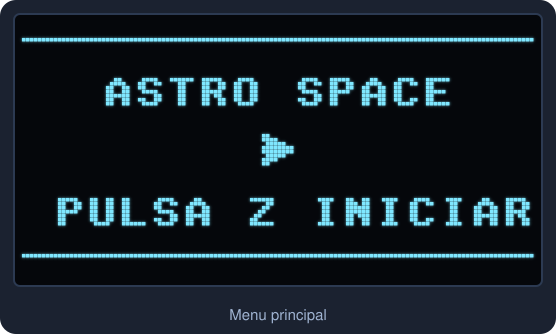
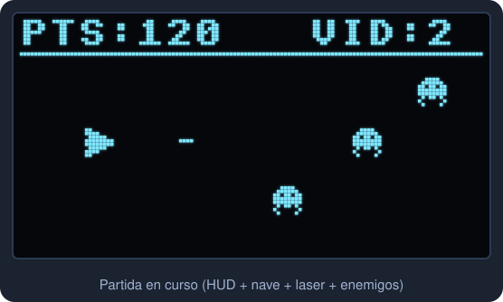
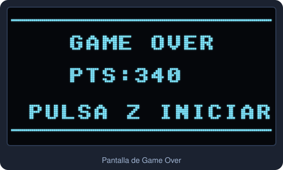
</div>

---

## 🎮 Cómo se juega

1. Conecta la Pico por USB. En la OLED aparece el menú **ASTRO SPACE**.
2. Presiona el **botón Z** (el botón del joystick) para empezar.
3. Mueve el joystick para esquivar a los enemigos y ponerte frente a ellos. El láser se dispara solo.
4. Cada enemigo destruido suma **10 puntos**. El HUD muestra `PTS:` y `VID:` en todo momento.
5. Cuando pierdes las 3 vidas aparece **GAME OVER** con tu puntuación. Presiona **Z** para jugar otra vez.

---

## ✅ Requisitos del proyecto y dónde se cumplen

| Requisito | Cómo se cumple | Dónde |
| :-- | :-- | :-- |
| **Ensamblador puro** | Toda la lógica, el dibujo, los periféricos y el timer están en archivos `.S`. El `.ino` solo tiene una línea que llama a `game_main()` | `*.S`, `Astro-Space-Arm.ino` |
| **Acceso directo a registros** | Se escriben las direcciones MMIO del RP2040 con máscaras de bits. No se usa ninguna función de Arduino ni del Pico SDK | `inputs.S`, `video.S`, `timer.S` |
| **Timer por hardware + NVIC** | `TIMER ALARM1` → `TIMER_IRQ_1`. La ISR se instala en una tabla de vectores en RAM (VTOR) y se habilita en el NVIC. No hay *delay loops* | `timer.S` |
| **Framebuffer en RAM** | Buffer de **1024 bytes** (128x64 / 8) que se envía completo a la OLED en cada cuadro | `video.S` |
| **Tasa fija ≥ 30 FPS** | Periodo de 33 333 µs → **30,0 Hz** | `timer.S` |
| **Menú principal** | Pantalla estática con el nombre del juego que arranca con el botón Z | `render_menu_screen` |
| **Control en ejes** | Lectura del ADC en X (GP26) y Y (GP27) con zona muerta y dos velocidades | `read_adc_x/y`, `adc_to_delta` |
| **Mecánicas** | Colisiones AABB, láser y enemigos automáticos, condición de fin | `update_game_physics` |
| **HUD con *font mapping*** | Tabla de 39 glifos de 8x8 (`A-Z`, `0-9`, espacio, `:` y `-`) | `font_table`, `fb_draw_char` |
| **Game Over** | Pantalla final, `timer_stop` detiene el timer y `reset_game_state` reinicia el estado | `main.S`, `timer.S` |
| **Código modular (E1)** | Cuatro módulos: `main`, `inputs`, `timer` y `video` | [Arquitectura](#-arquitectura-del-software) |
| **Pila y AAPCS (E1)** | Se preservan r4–r7 y lr y la pila queda alineada a 8 bytes | [Pila y AAPCS](#-uso-de-la-pila-y-estándar-aapcs) |
| **Comentarios (E1)** | Cada archivo tiene encabezado y cada subrutina indica parámetros, retorno y registros | Todos los `.S` |
| **Reporte técnico (E2)** | Mapa de memoria, diagrama de la FSM, conexiones y cálculo de tiempos | Este README (secciones de conexiones, máquina de estados, mapa de memoria y tiempos) |

---

## 🔧 Hardware utilizado

| Componente | Modelo | Función |
| :-- | :-- | :-- |
|  | **Raspberry Pi Pico** (RP2040, ARM Cortex-M0+ de doble núcleo, 264 KB SRAM, 2 MB flash) | Ejecuta el juego (se usa un solo núcleo) |
|  | **OLED 0.96" SSD1306** de 128 x 64 px, I2C, dirección `0x3C` | Salida de video monocromática |
|  | **Joystick analógico** (tipo KY-023: VRx, VRy, SW) | Movimiento en X/Y y botón Z |
|  | Protoboard, cables dupont y cable micro-USB **de datos** | Montaje y alimentación |

---

## 🔌 Esquema de conexión electrónica

### Diagrama

<div align="center">
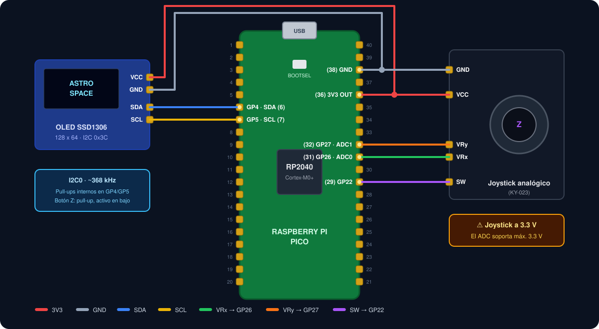
</div>

### Tabla de conexiones

| Señal | Pin físico Pico | GPIO | Periférico RP2040 | Dispositivo | Configuración en el código |
| :-- | :--: | :--: | :-- | :-- | :-- |
| Alimentación | **36** | 3V3(OUT) | — | OLED VCC y Joystick VCC | — |
| Tierra | **38** (o cualquier GND) | GND | — | OLED GND y Joystick GND | — |
| Datos I2C | **6** | GP4 | I2C0 SDA (FUNCSEL 3) | OLED SDA | Pull-up interno, Schmitt, 4 mA |
| Reloj I2C | **7** | GP5 | I2C0 SCL (FUNCSEL 3) | OLED SCL | Pull-up interno, Schmitt, 4 mA |
| Botón Z | **29** | GP22 | SIO (FUNCSEL 5) | Joystick SW | Entrada, pull-up interno, activo en bajo |
| Eje X | **31** | GP26 | ADC canal 0 | Joystick VRx | Pad analógico (IE=0, OD=1) |
| Eje Y | **32** | GP27 | ADC canal 1 | Joystick VRy | Pad analógico (IE=0, OD=1) |

> [!WARNING]
> **Alimenta el joystick con 3.3 V, no con 5 V.** El ADC del RP2040 trabaja con un máximo de 3.3 V. Si el joystick recibe 5 V, sus salidas VRx y VRy pueden superar ese límite y dañar los pines GP26 y GP27.

> [!NOTE]
> El botón SW del joystick conecta a GND al presionarse. Como el código activa el **pull-up interno** de GP22, no necesitas resistencias externas. La mayoría de los módulos OLED ya incluyen resistencias pull-up en SDA y SCL.

### Vista en texto (pinout lateral de la Pico)

```text
                 ┌───────── USB ─────────┐
   GP0   [ 1] ●  │                       │  ● [40] VBUS
   ...           │    RASPBERRY PI       │     ...
   GP4   [ 6] ●──┼── SDA  (OLED)         │  ● [38] GND ──── GND (OLED + Joystick)
   GP5   [ 7] ●──┼── SCL  (OLED)         │  ● [36] 3V3 ──── VCC (OLED + Joystick)
   ...           │        PICO           │  ● [32] GP27 ─── VRy (Joystick)
   ...           │       RP2040          │  ● [31] GP26 ─── VRx (Joystick)
   ...           │                       │  ● [29] GP22 ─── SW  (Botón Z)
                 └───────────────────────┘
```

---

## 🧱 Arquitectura del software

El código está dividido en **cuatro módulos en ensamblador** más un archivo `.ino` que solo sirve para arrancar.

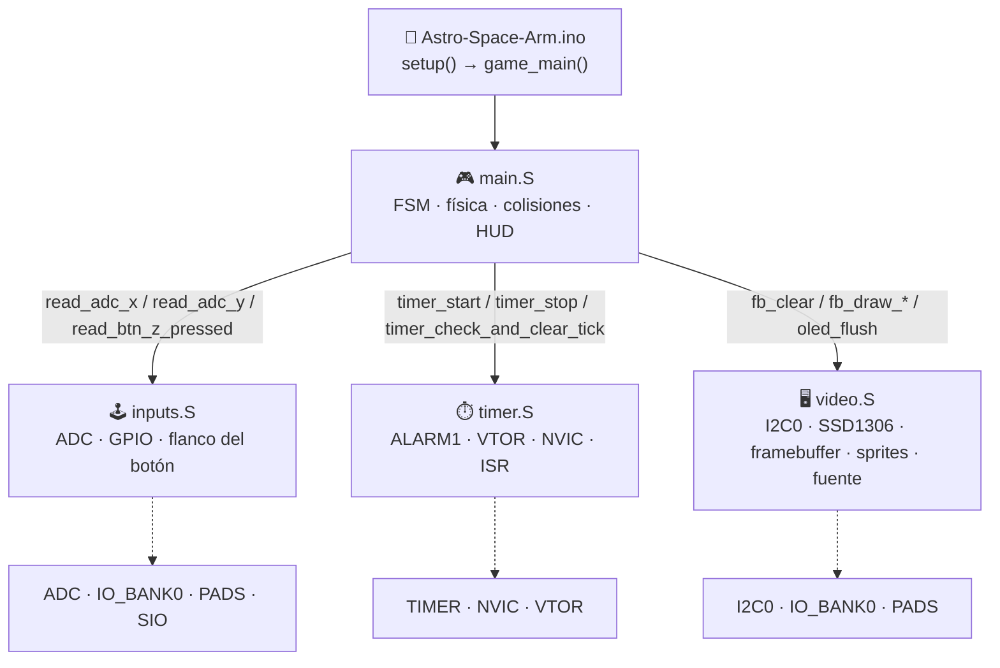

| Archivo | Responsabilidad | Funciones públicas |
| :-- | :-- | :-- |
| [`Astro-Space-Arm.ino`](Astro-Space-Arm.ino) | Punto de arranque mínimo (permitido por el enunciado). Llama a `game_main()` y nunca regresa | — |
| [`main.S`](main.S) | Máquina de estados, física, colisiones AABB, puntuación, vidas, LFSR y pantallas | `game_main` |
| [`inputs.S`](inputs.S) | Reloj y reset del ADC, pads analógicos, GPIO del botón, conversión a velocidad y detección de flanco | `inputs_init`, `read_adc_x`, `read_adc_y`, `read_btn_z_pressed` |
| [`timer.S`](timer.S) | ALARM1 del timer de 1 MHz, copia de la tabla de vectores a RAM, NVIC e ISR | `timer_init`, `timer_start`, `timer_stop`, `timer_check_and_clear_tick`, `timer1_isr` |
| [`video.S`](video.S) | Controlador I2C0, inicialización del SSD1306, framebuffer y rutinas para dibujar píxeles, líneas, sprites, texto y números | `video_init`, `fb_clear`, `fb_draw_pixel`, `fb_draw_hline`, `fb_draw_sprite`, `fb_draw_char`, `fb_draw_string`, `fb_draw_num3`, `oled_flush` |

> [!TIP]
> Los archivos usan la extensión **`.S` en mayúscula**, que es ensamblador GNU con preprocesador. Es la extensión que el IDE de Arduino compila y enlaza automáticamente junto con el sketch.

---

## 🔁 Máquina de estados del juego

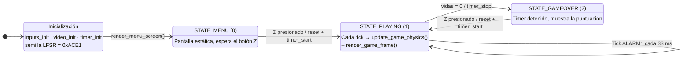

| Estado | Valor | Qué hace | Cómo sale |
| :-- | :--: | :-- | :-- |
| `STATE_MENU` | `0` | Muestra el título y lee el botón Z | Al presionar Z → `PLAYING` |
| `STATE_PLAYING` | `1` | Por cada tick: entrada, física, colisiones y dibujo | Con vidas = 0 → `GAMEOVER` |
| `STATE_GAMEOVER` | `2` | Pantalla final estática con el timer apagado | Al presionar Z → `PLAYING` |

### Diagrama de flujo del bucle principal

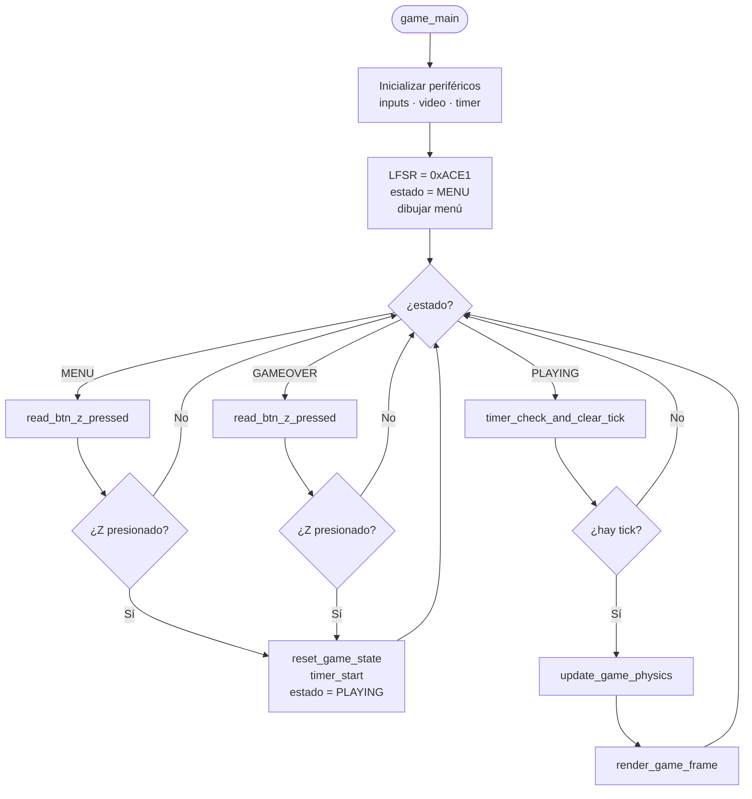

---

## 🔄 Ciclo de un cuadro (tick)

La **ISR solo levanta una bandera**. Todo el trabajo pesado se hace en el bucle principal, así la interrupción dura apenas unos ciclos.

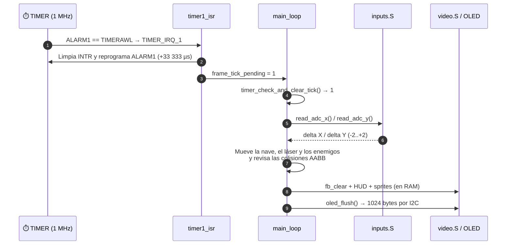

Dentro de `update_game_physics` el orden es siempre el mismo:

1. **Nave:** lee los ejes X y Y, aplica `adc_to_delta` y limita la posición a X ∈ [2, 96] y Y ∈ [12, 55].
2. **Láser:** si no hay uno activo, dispara desde `(x+8, y+3)`. Si hay uno, lo mueve +5 px y lo desactiva cuando X ≥ 126.
3. **Enemigos (i = 0..2):** los mueve −2 px y revisa tres casos: si salieron por la izquierda (reaparecen a la derecha sin quitar vida), si los alcanzó el láser (+10 puntos) o si chocaron con la nave (−1 vida).
4. **Fin:** si las vidas llegan a 0, llama a `timer_stop`, cambia a `STATE_GAMEOVER` y dibuja la pantalla final.

---

## 🧭 Mapa de memoria

### Espacio de direcciones del RP2040 utilizado

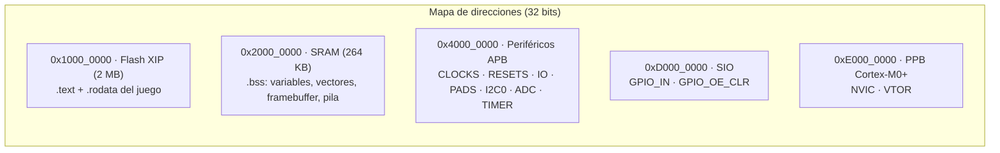

### Registros de periféricos (MMIO) que usa el código

| Bloque | Dirección base | Registros usados (dirección) | Módulo | Uso |
| :-- | :-- | :-- | :-- | :-- |
| **CLOCKS** | `0x4000_8000` | `CLK_ADC_CTRL` (`0x4000_8060`) | inputs | Habilita el reloj del ADC (bit 11) |
| **RESETS** | `0x4000_C000` | `RESET` clear (`0x4000_F000`), `RESET_DONE` (`0x4000_C008`) | todos | Saca de reset ADC(0), I2C0(3), IO_BANK0(5), PADS_BANK0(8) y TIMER(21) |
| **IO_BANK0** | `0x4001_4000` | `GPIO4_CTRL` (`…024`), `GPIO5_CTRL` (`…02C`), `GPIO22_CTRL` (`…0B4`) | inputs, video | Selección de función: I2C (3) o SIO (5) |
| **PADS_BANK0** | `0x4001_C000` | `GPIO4` (`…014`), `GPIO5` (`…018`), `GPIO22` (`…05C`), `GPIO26` (`…06C`), `GPIO27` (`…070`) | inputs, video | Pull-up, Schmitt, IE/OD y modo analógico |
| **I2C0** | `0x4004_4000` | `IC_CON` (`+0x00`), `IC_TAR` (`+0x04`), `IC_DATA_CMD` (`+0x10`), `FS_SCL_HCNT/LCNT` (`+0x1C/+0x20`), `CLR_TX_ABRT` (`+0x54`), `ENABLE` (`+0x6C`), `STATUS` (`+0x70`), `FS_SPKLEN` (`+0xA0`) | video | Maestro I2C en modo rápido hacia la OLED |
| **ADC** | `0x4004_C000` | `CS` (`+0x00`), `RESULT` (`+0x04`) | inputs | Conversión única de 12 bits en AIN0 y AIN1 |
| **TIMER** | `0x4005_4000` | `ALARM1` (`+0x14`), `ARMED` (`+0x20`), `TIMERAWL` (`+0x28`), `INTR` (`+0x34`), `INTE` (`+0x38`) | timer | Base de tiempo de 1 µs y alarma de 33 333 µs |
| **SIO** | `0xD000_0000` | `GPIO_IN` (`+0x04`), `GPIO_OE_CLR` (`+0x28`) | inputs | Lectura del botón y configurarlo como entrada |
| **PPB** | `0xE000_0000` | `NVIC_ISER` (`0xE000_E100`), `NVIC_ICPR` (`0xE000_E280`), `VTOR` (`0xE000_ED08`) | timer | Habilitar IRQ1 y reubicar la tabla de vectores |

### Uso de memoria del programa

Tamaños obtenidos al ensamblar cada módulo para `thumbv6m` (Cortex-M0+):

| Módulo | `.text` (código, flash) | `.rodata` (constantes, flash) | `.bss` (variables, RAM) |
| :-- | --: | --: | --: |
| `main.S` | 936 B | 64 B | 60 B |
| `inputs.S` | 276 B | — | 4 B |
| `timer.S` | 244 B | — | 448 B * |
| `video.S` | 600 B | 340 B | 1024 B |
| **Total** | **2 056 B** | **404 B** | **1 536 B** |

<sub>* 8 B de banderas + 56 B de relleno para alinear a 256 B + 192 B de la tabla de vectores. El tamaño exacto del relleno depende de dónde quede la sección al enlazar.</sub>

En total el juego ocupa **≈ 2,4 KB de flash (0,12 % de 2 MB)** y **≈ 1,5 KB de RAM (0,58 % de 264 KB)**. No usa memoria dinámica (`malloc`).

<details>
<summary><b>📦 Variables en RAM (.bss), una por una</b></summary>

<br/>

| Variable | Módulo | Desplazamiento | Tamaño | Rango o uso |
| :-- | :-- | :--: | :--: | :-- |
| `current_game_state` | main | `+0x00` | 4 B | 0 = MENU, 1 = PLAYING, 2 = GAMEOVER |
| `player_score` | main | `+0x04` | 4 B | 0..999 |
| `remaining_lives` | main | `+0x08` | 4 B | 0..3 |
| `player_position_x` | main | `+0x0C` | 4 B | 2..96 |
| `player_position_y` | main | `+0x10` | 4 B | 12..55 |
| `laser_position_x` | main | `+0x14` | 4 B | X del láser |
| `laser_position_y` | main | `+0x18` | 4 B | Y del láser |
| `laser_in_flight` | main | `+0x1C` | 4 B | 0 / 1 |
| `enemy_positions_x[3]` | main | `+0x20` | 12 B | X de cada enemigo |
| `enemy_positions_y[3]` | main | `+0x2C` | 12 B | Y de cada enemigo (14..45 al reaparecer) |
| `enemy_height_lfsr_state` | main | `+0x38` | 4 B | Estado del LFSR de 16 bits |
| `previous_button_z_state` | inputs | `+0x00` | 4 B | Último nivel de GP22 (para detectar el flanco) |
| `frame_tick_pending` | timer | `+0x00` | 4 B | Bandera ISR → bucle principal |
| `physics_timer_enabled` | timer | `+0x04` | 4 B | 1 = timer de física activo |
| `interrupt_vectors_ram` | timer | `+0x100` | 192 B | 48 vectores (16 excepciones + 32 IRQ), alineados a 256 B |
| `framebuffer` | video | `+0x000` | 1024 B | 128 x 64 px, 1 bit por píxel |

</details>

<details>
<summary><b>🧩 Constantes en flash (.rodata)</b></summary>

<br/>

| Símbolo | Módulo | Tamaño | Contenido |
| :-- | :-- | :--: | :-- |
| `sprite_player` | main | 8 B | Nave 8x8 |
| `sprite_enemy` | main | 8 B | Enemigo 8x8 |
| `str_title`, `str_press_z`, `str_hud_pts`, `str_hud_vid`, `str_gameover` | main | 48 B | Textos terminados en `\0` |
| `oled_init_cmds` | video | 28 B | Secuencia de inicialización del SSD1306 |
| `font_table` | video | 312 B | 39 glifos x 8 bytes |

</details>

### Organización del framebuffer

La OLED divide la pantalla en **8 páginas** horizontales de 8 filas. Cada byte del framebuffer es **una columna de 8 píxeles** dentro de una página, y el bit 0 es el píxel de arriba.

```text
               X →   0        1        2      ...     127
            ┌────────┬────────┬────────┬─────┬────────┐
 Página 0   │ byte 0 │ byte 1 │ byte 2 │ ... │byte 127│   filas Y = 0..7
 (Y 0..7)   │ bit0=Y0│        │        │     │        │
            │  ...   │        │        │     │        │
            │ bit7=Y7│        │        │     │        │
            ├────────┼────────┼────────┼─────┼────────┤
 Página 1   │byte 128│byte 129│  ...   │     │byte 255│   filas Y = 8..15
            ├────────┴────────┴────────┴─────┴────────┤
   ...      │                    ...                   │
            ├────────┬────────┬────────┬─────┬────────┤
 Página 7   │byte 896│  ...   │        │     │byte1023│   filas Y = 56..63
            └────────┴────────┴────────┴─────┴────────┘

   índice = (Y >> 3) * 128 + X        máscara = 1 << (Y & 7)
```

---

## ⌛ Cálculo de tiempos de refresco

### 1. Periodo del temporizador (tasa de cuadros)

El TIMER del RP2040 cuenta **microsegundos** (1 MHz) y ALARM1 se reprograma cada `FRAME_PERIOD_US = 33 333`:

$$
T_{tick} = 33\,333 \ \mu s = 33{,}333 \ ms \qquad\Rightarrow\qquad f = \frac{1}{33{,}333 \times 10^{-3}\ s} \approx \mathbf{30{,}0\ Hz}
$$

### 2. Velocidad del bus I2C

En modo rápido, el periodo de SCL lo fijan `IC_FS_SCL_HCNT = 150` y `IC_FS_SCL_LCNT = 190` ciclos del reloj del sistema:

$$
f_{SCL} = \frac{f_{clk\_sys}}{HCNT + LCNT} = \frac{125\ MHz}{150 + 190} = \frac{125 \times 10^{6}}{340} \approx \mathbf{368\ kHz}
\qquad\Rightarrow\qquad t_{bit} \approx 2{,}72\ \mu s
$$

### 3. Tiempo de envío de un cuadro completo (`oled_flush`)

En I2C, cada byte ocupa **9 bits** (8 de datos + 1 ACK):

| Parte | Transacciones | Bytes por transacción | Bits |
| :-- | :--: | :-- | --: |
| Ventana (`0x21 0 127`, `0x22 0 7`) | 6 | dirección + `0x00` + comando = 3 | 6 × 3 × 9 = **162** |
| Datos (8 páginas) | 8 | dirección + `0x40` + 128 datos = 130 | 8 × 130 × 9 = **9 360** |
| **Total** | 14 | | **≈ 9 522 bits** |

$$
t_{flush} \approx 9\,522 \times 2{,}72\ \mu s \approx \mathbf{25{,}9\ ms}
$$

### 4. Presupuesto de tiempo por cuadro

| Tarea | Tiempo aprox. | Cálculo |
| :-- | --: | :-- |
| Lectura del ADC (2 conversiones) | 0,004 ms | 96 ciclos @ 48 MHz = 2 µs por canal |
| Física, colisiones y dibujo en RAM | < 0,5 ms | Menos de ~60 000 ciclos @ 125 MHz (estimado) |
| Envío I2C a la OLED | ≈ 25,9 ms | Calculado arriba |
| **Total ocupado** | **≈ 26,4 ms** | |
| **Periodo disponible** | **33,3 ms** | 30 FPS |
| **Margen libre** | **≈ 6,9 ms (≈ 21 %)** | ✅ El juego mantiene los 30 FPS |

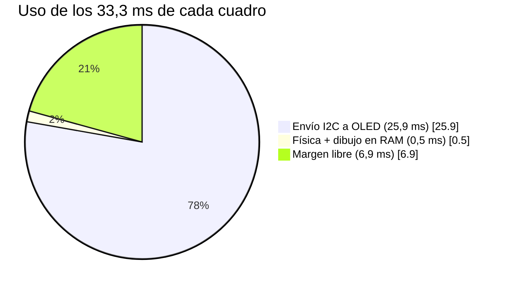

### 5. Velocidades en pantalla

| Objeto | px por cuadro | px por segundo (× 30) | Observación |
| :-- | :--: | :--: | :-- |
| Nave (inclinación suave) | 1 | 30 px/s | ADC entre 600–1499 o 2601–3500 |
| Nave (inclinación fuerte) | 2 | 60 px/s | ADC < 600 o > 3500 |
| Láser | 5 | 150 px/s | Cruza la pantalla en ≈ 0,8 s |
| Enemigos | 2 | 60 px/s | Desde X = 128 tardan ≈ 2,1 s en llegar al borde |

> [!IMPORTANT]
> Los valores de `HCNT/LCNT` se calcularon para **clk_sys = 125 MHz**. Si en el IDE de Arduino eliges otra velocidad de CPU, el reloj I2C cambia en la misma proporción. Por ejemplo, a 133 MHz da ≈ 391 kHz, que sigue dentro de los 400 kHz del modo rápido. Se recomienda usar **125 o 133 MHz** en *Tools → CPU Speed*.

---

## 🧠 Uso de la pila y estándar AAPCS

Todas las subrutinas siguen el **ARM Architecture Procedure Call Standard (AAPCS)**:

| Regla AAPCS | Cómo se aplica en ASTRO SPACE |
| :-- | :-- |
| **r0–r3** son registros de argumentos y de retorno, y la función llamada puede destruirlos | Los parámetros (X, Y, puntero, valor) entran en r0–r2 y el resultado sale en r0 (por ejemplo, `read_adc_x` devuelve el delta en r0) |
| **r4–r7** los preserva la función llamada | Toda subrutina que usa r4–r7 los guarda con `push` al entrar y los restaura con `pop` al salir |
| **lr** se guarda si la función llama a otra | Se apila `lr` y se regresa con `pop {..., pc}` |
| La **pila queda alineada a 8 bytes** | Siempre se apila un número **par** de registros. Por eso a veces se agrega `r3` o `r4` aunque no se usen (por ejemplo, `push {r3, r4, r5, lr}`) |
| Las **funciones hoja** no tocan la pila | `next_random_y`, `lose_one_life`, `adc_to_delta`, `fb_clear`, `fb_draw_pixel`, `i2c_wait_*` y `timer_check_and_clear_tick` regresan con `bx lr` |
| Los **valores vivos** sobreviven a las llamadas | El índice del enemigo (`r7`), los punteros a los arreglos (`r4`, `r5`) y el desplazamiento (`r6`) se guardan en registros preservados dentro de `update_game_physics` |

<details>
<summary><b>📋 Tabla completa de marcos de pila por subrutina</b></summary>

<br/>

| Subrutina | Módulo | `push` | Bytes | ¿Hoja? |
| :-- | :-- | :-- | :--: | :--: |
| `game_main` | main | `{r4, lr}` | 8 | |
| `reset_game_state` | main | `{r4, lr}` | 8 | |
| `next_random_y` | main | — | 0 | ✅ |
| `update_game_physics` | main | `{r3, r4, r5, r6, r7, lr}` | 24 | |
| `lose_one_life` | main | — | 0 | ✅ |
| `render_menu_screen` | main | `{r4, lr}` | 8 | |
| `render_game_frame` | main | `{r4, r5, r6, lr}` | 16 | |
| `render_gameover_screen` | main | `{r4, lr}` | 8 | |
| `inputs_init` | inputs | `{r4, lr}` | 8 | |
| `read_adc_x` / `read_adc_y` | inputs | `{r4, lr}` | 8 | |
| `adc_to_delta` | inputs | — | 0 | ✅ |
| `read_btn_z_pressed` | inputs | `{r4, lr}` | 8 | |
| `timer_init` / `timer_start` / `timer_stop` | timer | `{r4, lr}` | 8 | |
| `timer_check_and_clear_tick` | timer | — | 0 | ✅ |
| `timer1_isr` | timer | `{r4, lr}` (+ 32 B que apila el hardware) | 8 + 32 | |
| `video_init` | video | `{r4, r5, r6, lr}` | 16 | |
| `i2c_wait_tfnf` / `i2c_wait_idle` | video | — | 0 | ✅ |
| `oled_send_cmd` | video | `{r4, lr}` | 8 | |
| `oled_flush` | video | `{r4, r5, r6, lr}` | 16 | |
| `fb_clear` / `fb_draw_pixel` | video | — | 0 | ✅ |
| `fb_draw_hline` | video | `{r3, r4, r5, lr}` | 16 | |
| `fb_draw_sprite` | video | `{r3–r7, lr}` + `{r2, r3}` temporal | 24 + 8 | |
| `fb_draw_char` | video | `{r4, lr}` | 8 | |
| `fb_draw_string` | video | `{r4, r5, r6, lr}` | 16 | |
| `fb_draw_num3` | video | `{r3–r7, lr}` | 24 | |

</details>

### Profundidad máxima de la pila

La cadena de llamadas más profunda ocurre cuando, dentro de un tick, se pierde la última vida y se dibuja la pantalla de Game Over:

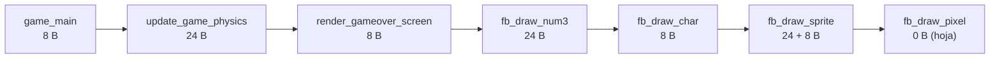

$$
8 + 24 + 8 + 24 + 8 + 32 = \mathbf{104\ bytes} \quad (+\ 40\ B\ \text{si la ISR interrumpe en ese momento}) \approx \mathbf{144\ bytes}
$$

Esto es muy poco comparado con la pila de varios KB que reserva el núcleo de Arduino, así que **no hay riesgo de desbordamiento**.

### Ejemplo comentado

```asm
/* fb_draw_sprite: r0 = X, r1 = Y, r2 = puntero al bitmap */
fb_draw_sprite:
    push {r3, r4, r5, r6, r7, lr}   @ 6 registros = 24 B → pila alineada a 8
    movs r4, r0                     @ r4..r7 sobreviven a las llamadas internas
    ...
    push {r2, r3}                   @ fb_draw_pixel destruye r2 y r3 (son scratch)
    bl   fb_draw_pixel
    pop  {r2, r3}
    ...
    pop  {r3, r4, r5, r6, r7, pc}   @ restaura y regresa en una sola instrucción
```

---

## 🔬 Detalles de implementación

<details>
<summary><b>🕹️ Joystick: de lectura ADC a velocidad (zona muerta)</b></summary>

<br/>

El ADC entrega un valor de 12 bits (0–4095, con el centro en ≈ 2048). `adc_to_delta` lo traduce así:

| Lectura ADC | Delta | Significado |
| :--: | :--: | :-- |
| 0 – 599 | **−2** | Inclinación fuerte |
| 600 – 1499 | **−1** | Inclinación suave |
| 1500 – 2600 | **0** | Zona muerta (reposo) |
| 2601 – 3500 | **+1** | Inclinación suave |
| 3501 – 4095 | **+2** | Inclinación fuerte |

La zona muerta evita que la nave se mueva sola por el ruido del potenciómetro.

</details>

<details>
<summary><b>💥 Colisiones AABB</b></summary>

<br/>

Dos rectángulos alineados a los ejes se tocan cuando se solapan **en X y en Y al mismo tiempo**:

```text
A.x + 7 >= B.x   &&   A.x <= B.x + 7      (eje X, cajas de 8 px)
A.y + 7 >= B.y   &&   A.y <= B.y + 7      (eje Y)
```

- **Nave vs. enemigo:** cajas de 8x8.
- **Láser vs. enemigo:** láser de 4 px de largo con margen +4 en X y +2 en Y.

</details>

<details>
<summary><b>🎲 Alturas pseudoaleatorias (LFSR de Galois)</b></summary>

<br/>

```text
nuevo = estado >> 1
si (estado & 1) entonces nuevo ^= 0xB400      ; polinomio x^16 + x^14 + x^13 + x^11 + 1
Y = (nuevo & 31) + 14                         ; rango 14..45, debajo del HUD
```

La semilla `0xACE1` se carga una sola vez al arrancar. El estado no se reinicia entre partidas, así que cada partida tiene una secuencia distinta.

</details>

<details>
<summary><b>🔘 Botón Z por flanco de bajada</b></summary>

<br/>

`read_btn_z_pressed` compara el nivel actual de GP22 con el anterior y devuelve `1` solo cuando pasa de **1 → 0** (suelto → presionado). Así una pulsación larga cuenta como una sola y no salta varias pantallas.

</details>

<details>
<summary><b>⚡ Instalación de la interrupción sin SDK (VTOR)</b></summary>

<br/>

1. Se lee `VTOR` para encontrar la tabla de vectores actual.
2. Se copian sus **48 entradas** a `interrupt_vectors_ram`, alineada a 256 bytes como exige VTOR.
3. Se escribe la dirección de `timer1_isr | 1` (el bit 0 indica modo Thumb) en el desplazamiento `0x44`, que corresponde a IRQ 1.
4. Se apunta `VTOR` a la copia en RAM y se ejecutan `dsb` e `isb`.
5. Se limpia la IRQ1 pendiente (`NVIC_ICPR`) y se habilita (`NVIC_ISER`).

</details>

<details>
<summary><b>🔢 Números sin instrucción de división</b></summary>

<br/>

El Cortex-M0+ **no tiene instrucción de división**. `fb_draw_num3` obtiene las centenas y las decenas restando 100 y 10 repetidamente, y lo que sobra son las unidades. Siempre dibuja 3 cifras (por ejemplo, `040`).

</details>

---

## 🔨 Compilación y carga

> El IDE de Arduino se usa **solo como herramienta de compilación y carga**. El juego **no llama a ninguna función de Arduino**: el sketch solo ejecuta `game_main()`.

### Requisitos

| Herramienta | Versión sugerida |
| :-- | :-- |
|  | 2.x |
|  | *Raspberry Pi Pico/RP2040* de Earle F. Philhower |
|  | RP2040 |

### Pasos

1. **Clona el repositorio:**
   ```bash
   git clone https://github.com/ItsRomero/Astro-Space-Arm.git
   ```
2. **Instala el núcleo de la Pico** en Arduino IDE. En *File → Preferences → Additional boards manager URLs* agrega:
   ```text
   https://github.com/earlephilhower/arduino-pico/releases/download/global/package_rp2040_index.json
   ```
   Luego, en *Boards Manager*, busca e instala **Raspberry Pi Pico/RP2040**.
3. **Abre** `Astro-Space-Arm/Astro-Space-Arm.ino`. La carpeta y el `.ino` deben llamarse igual, y los cuatro `.S` se cargan automáticamente.
4. **Selecciona** *Tools → Board → Raspberry Pi Pico* y *Tools → CPU Speed → 125 MHz* (o 133 MHz).
5. **Conecta** la Pico manteniendo presionado **BOOTSEL** y luego presiona **Upload**.
6. Al reiniciar, la OLED muestra el menú **ASTRO SPACE**. 🚀

---

## 📁 Estructura del repositorio

```text
Astro-Space-Arm/
├── Astro-Space-Arm.ino     # Arranque mínimo: setup() → game_main()
├── main.S                  # Máquina de estados, física, colisiones y HUD
├── inputs.S                # ADC del joystick y botón Z (GPIO)
├── timer.S                 # TIMER ALARM1, VTOR, NVIC e ISR (30 Hz)
├── video.S                 # I2C0, SSD1306, framebuffer, sprites y fuente 8x8
├── README.md               # Este documento
└── assets/
    ├── banner.svg          # Banner del README
    ├── screen-menu.svg     # Pantalla: menú
    ├── screen-game.svg     # Pantalla: partida
    └── screen-gameover.svg # Pantalla: game over
```

---

## 👤 Autor

<div align="center">

**Oliver Romero**

<a href="https://github.com/ItsRomero"></a>
<a href="https://github.com/ItsRomero/Astro-Space-Arm"></a>

Proyecto final · **Arquitectura de Computadoras II**

<sub>Hecho con 🚀 y muchas instrucciones <code>ldr</code>/<code>str</code> sobre un Cortex-M0+.</sub>

</div>
